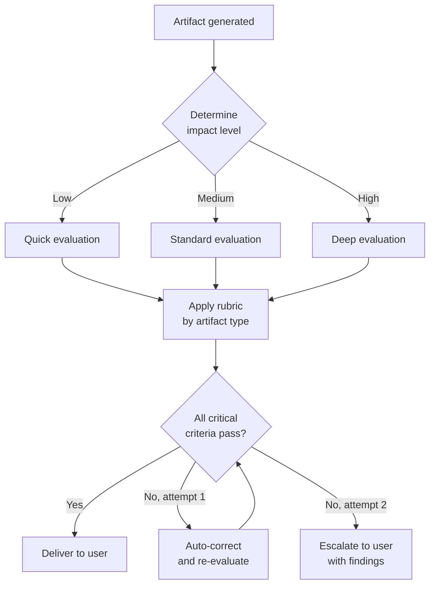
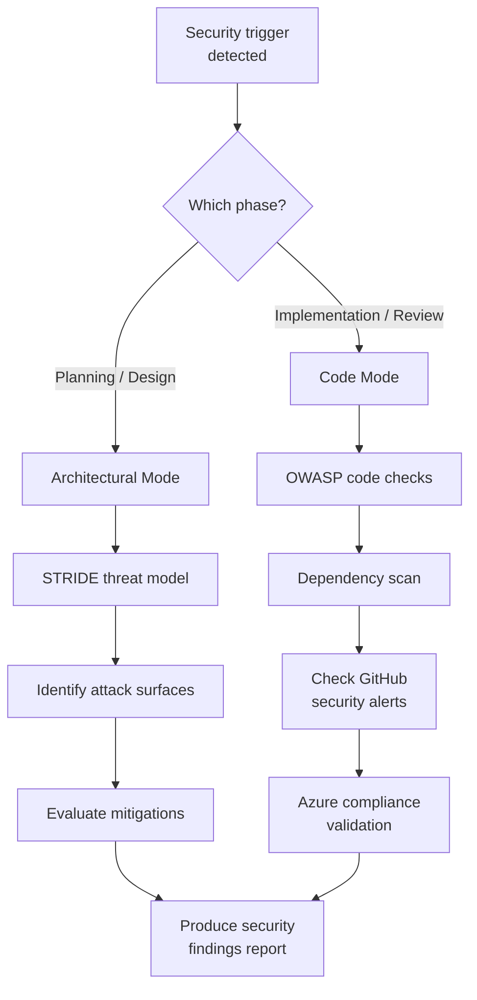

import { Aside, Badge } from '@astrojs/starlight/components';

These skills enforce quality standards through artifact validation, behavior-focused testing, security assessment, and documentation formatting.

## quality-gate <Badge text="specify, plan, decompose, review" variant="tip" />

Validates SDD artifacts at the point of creation. Applies rubrics scaled by impact level, with a maximum of 2 correction iterations before escalating to the user.

**Evaluation levels:**
| Level | Trigger | Depth |
|-------|---------|-------|
| Quick | Minor changes, low-impact tasks | Surface-level checks |
| Standard | Normal features, medium-impact | Full rubric evaluation |
| Deep | High-impact, cross-cutting changes | Exhaustive validation with cross-references |

**Rubrics by artifact type:**
| Artifact | Key Criteria |
|----------|-------------|
| Spec | Testable requirements, prioritized stories, conformance criteria (min 3), no implementation detail |
| ADR | Ranked priorities before options, options evaluated against priorities, valid status |
| Tasks | Organized by story, correct phase ordering (Models then Services then Endpoints then Integration), no separate test tasks |
| Code | Matches spec intent, follows ADR decisions, test coverage, no regressions |

**Convergence rule:** Maximum 2 auto-correction iterations. If the artifact still fails after 2 attempts, the skill presents findings to the user with specific failure points.

<Aside>
  Quality gate does not apply to intermediate artifacts marked as draft or WIP. It activates only at the point of delivery.
</Aside>

**Activation triggers:** Spec generation, ADR creation, task decomposition, code review.

---

## test-discipline <Badge text="implement, review" variant="tip" />

Guides behavior-focused tests through public interfaces, with independent expected outcomes and tests that survive internal refactoring.

| Scenario | Guidance |
|----------|----------|
| Feature or bug fix | Derive expectations from requirements, concrete examples, or independently justified properties |
| Tautological assertion | Avoid copying production calculations or deriving the expectation from the result being tested |
| Behavior-preserving refactor | Run and reuse existing behavioral tests, adding tests only for concrete coverage gaps |
| Test review | Identify a plausible contract violation the assertion would catch and report concrete gaps |

For example, a contract specifying a 20 percent discount on 1,000 cents establishes an expected payable amount of 800 cents. An assertion that copies a buggy calculation returning the discount amount can pass while violating that contract.

Computed expectations, shared fixture builders, snapshots, property-based tests, independent reference implementations, and mocks remain valid when they provide meaningful contract evidence. Review what they prove and whether a shared mistake could pass unnoticed.

**Activation triggers:** Feature implementation, bug fixes, refactoring, test additions, and test-quality review. These checks use the existing test workflow and do not require mutation-testing tooling.

---

## security-review <Badge text="plan, implement, review" variant="tip" />

Security assessment in two modes: architectural (during design) and code (during implementation). Covers STRIDE threat modeling, OWASP guidelines, dependency scanning, and compliance checks.

**Mode detection:**
| Signal | Mode |
|--------|------|
| Spec review, ADR creation, architecture planning | Architectural |
| Code changes, PR review, implementation | Code |

**Architectural mode (STRIDE):**
- Spoofing: Authentication boundaries
- Tampering: Data integrity controls
- Repudiation: Audit trail coverage
- Information Disclosure: Data classification and encryption
- Denial of Service: Rate limiting, resource quotas
- Elevation of Privilege: Authorization model

**Code mode (OWASP + tooling):**
- Input validation and output encoding
- Authentication and session management
- Dependency vulnerability scanning
- GitHub Advanced Security alerts review
- Azure compliance baseline checks

**Security principles applied:** CIA Triad, Defense in Depth, Least Privilege, Secure by Default, Zero Trust, Shift Left.

**Activation triggers:** Authentication logic, sensitive data handling, external integrations, exposed endpoints, data persistence patterns.

---

## documentation-style <Badge text="All doc-producing agents" variant="note" />

Formatting and style rules for all markdown documentation generated in the project. Applied automatically when agents produce specs, ADRs, envisioning documents, task files, or plan files.

**Formatting rules:**
| Rule | Detail |
|------|--------|
| Spelling | No errors allowed |
| Emojis | Prohibited, including decorative Unicode |
| Em dashes | Rephrase sentences without introducing Unicode U+2014 in newly written or rewritten Markdown |
| Semicolons | Recast newly written or rewritten prose naturally using conjunctions, clearer structure, or separate sentences when appropriate |
| Separators | Rephrase sentences instead of separating concepts with hyphens |
| Work item references | Never use `#<number>` in free text (Azure DevOps auto-links) |
| Structure | Lists and tables over long paragraphs |
| Names and references | Prefer descriptive names and links over invented codes for stories, requirements, scenarios, risks, and findings |
| Length | Specs and ADRs should be 1-2 pages |

Preserve meaning and natural flow rather than mechanically replacing semicolons with periods or splitting connected ideas into short, abrupt sentences. Keep semicolons required by code, technical syntax, or verbatim quotations.

Preserve existing text outside the requested scope. Do not scan or rewrite documents solely to remove existing em dashes or semicolons. Ordinary hyphens in compound words, identifiers, Markdown lists, and tables remain allowed.

Use formal identifiers only when explicitly requested or required by an established project convention, compliance process, or artifact-specific rules. Keep ordinary numbered procedures, meaningful numeric values, native board IDs, existing ADR numbers, and technical identifiers. Avoid repeating the same requirement solely to assign another code.

Apply the naming defaults only to newly written or rewritten text. Preserve existing identifiers and references outside the requested scope. Current spec templates and verification rules still require requirement and conformance IDs, which remain supported until those contracts are updated together.

For generated work item titles, the `work-item-creation` skill explicitly excludes sequential task and story prefixes such as `T-1`, `T001`, and `US-01`. It retains feature prefixes and native board identity without renaming existing work items.

**Language rules:**
| Avoid | Prefer |
|-------|--------|
| "it's not just X, it's Y" | Describe directly what it is |
| "goes beyond..." | State the specific capability |
| Rhetorical questions with obvious answers | Direct assertions |
| Generic framing (works in any project) | Project-specific context |
| Passive voice | Active voice, direct sentences |
| Academic or uncommon wording such as "locus" or "utilize" | Plain words such as "location" or "use" when meaning is unchanged |

Use wording that non-native English speakers can follow. Preserve precise domain terms, API names, code identifiers, and verbatim quotations, and explain necessary unfamiliar terms on first use.

**Document structure:** Start with the most important content (conclusion, decision, summary). Use consistent hierarchical headings. Include metadata when relevant (Status, Date, Version).

<Aside>
  This skill applies to project documentation only. It does not apply to source code comments, commit messages, or work item content.
</Aside>

**Activation triggers:** Spec writing, ADR creation, envisioning documents, task decomposition files, plan files.

---

## What to Read Next

- [Architecture and Planning Skills](../../skills/architecture/) for ADR and decision-recording workflows
- [Choosing the Right Extension](../../core-components/comparison/) for when to use skills vs other mechanisms